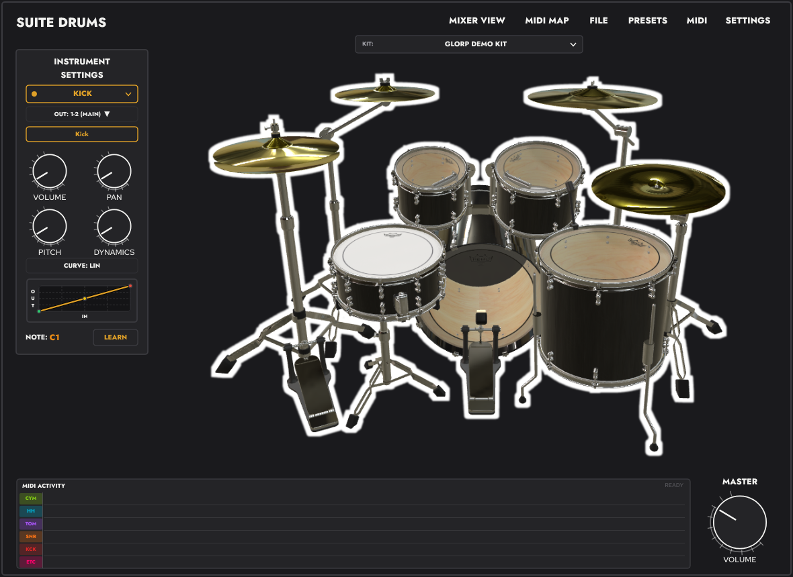
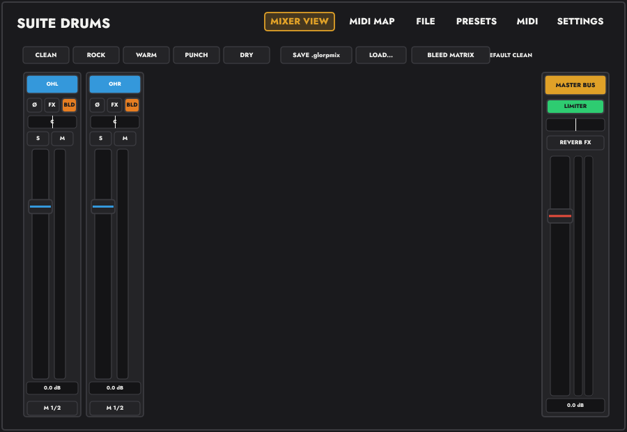
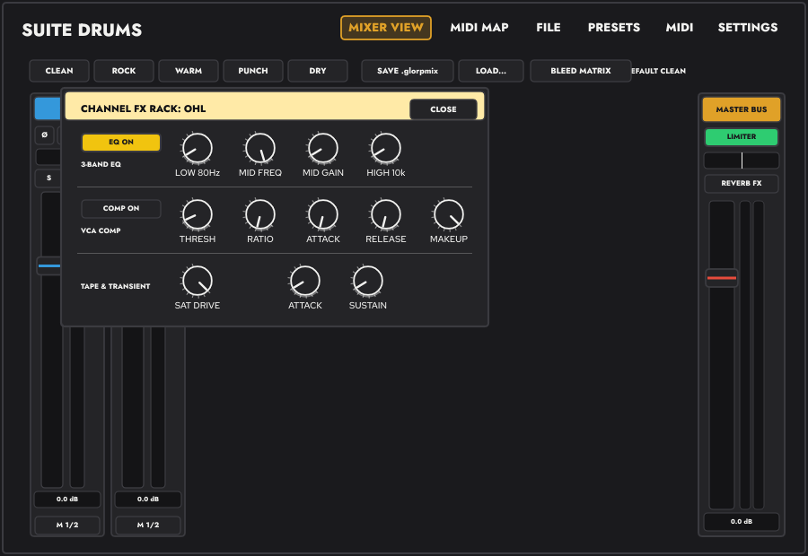
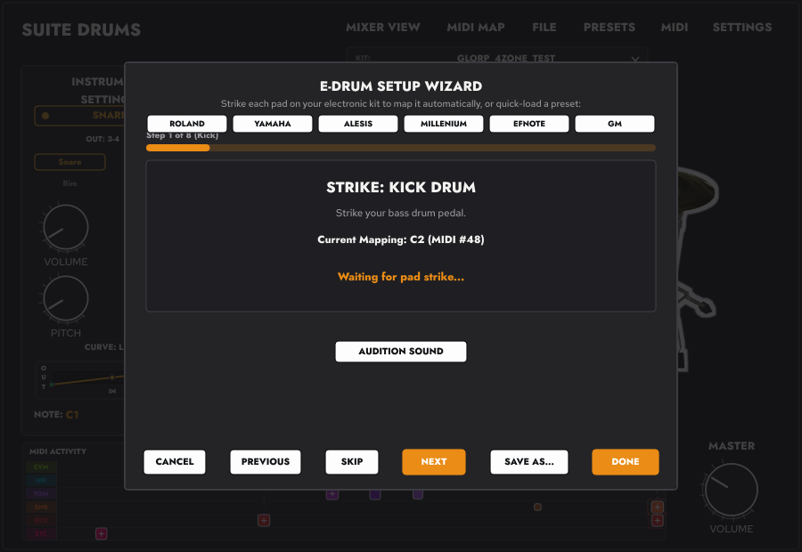
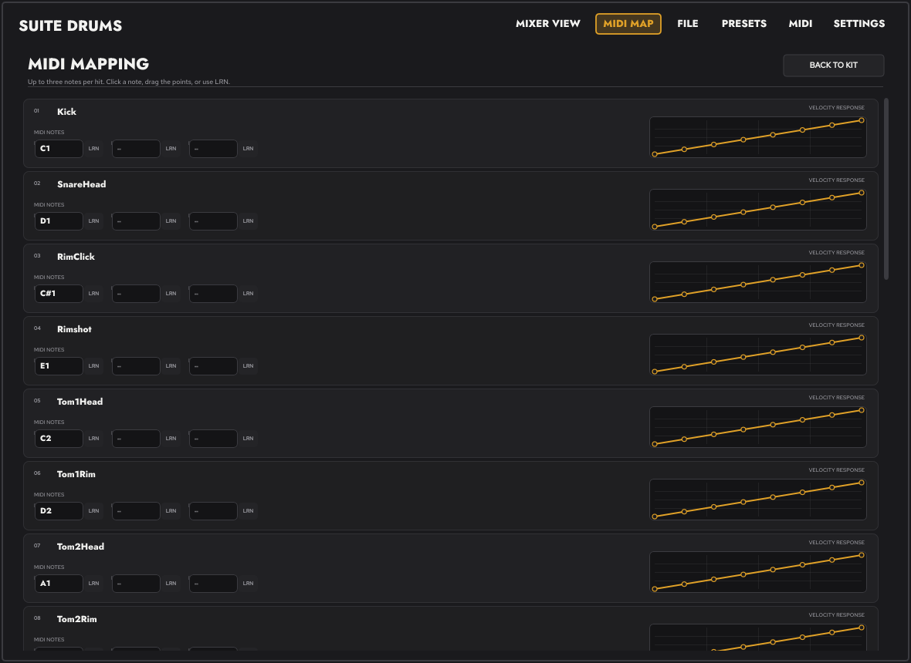
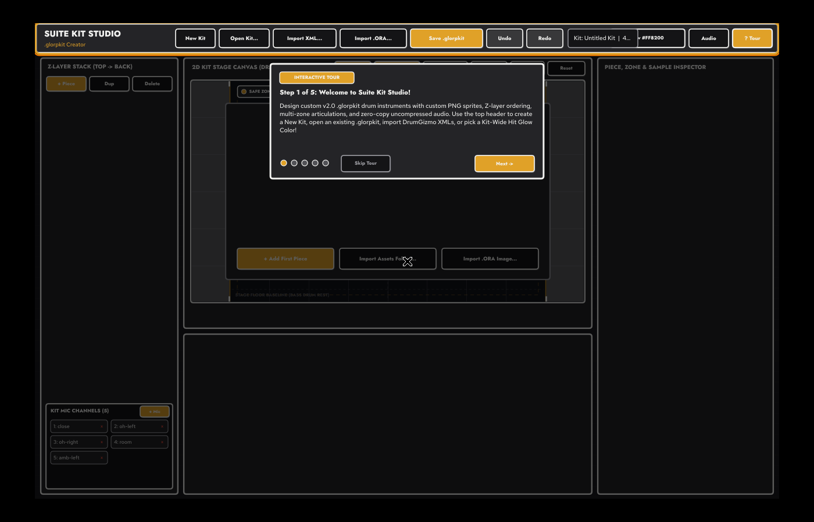

# Suite Drums Glorp

**Suite Drums Glorp** is a sample-based acoustic drum instrument for Linux, built with JUCE and C++20. It is the drum module of the **Suite** series: a focused VST3/LV2 plugin with the Glorp drum engine, interactive kit view, per-mic mixer, channel FX, e-drum support, multi-mic bleed matrix and the `.glorpkit` editor.



> [!NOTE]
> Suite Drums Glorp is an early alpha. It is a fork of [GlorpDrums](https://github.com/asuka-glorp/GlorpDrums) with the practice, recording and streaming features removed. The drum engine, kit view, mixer, FX, e-drum input, bleed matrix and kit editor remain.

## What is included

- **VST3 and LV2** instrument plugins for Linux x86_64.
- **Suite Kit Studio**, a standalone `.glorpkit` creator/editor.
- **One Suite theme**: dark charcoal, amber accent, Jost ExtraBold display type.
- **Kit view** with zones, velocity layers, round-robin, drum-hit animation and MIDI activity ribbon.
- **Per-piece controls** for level, pan, pitch and dynamic response.
- **Mixer** with per-mic channels, solo/mute, stems and master bus.
- **Channel FX**: 3-band EQ, VCA compressor, tape saturation and transient shaper.
- **MIDI mapping page**: up to three notes per hit, per-slot MIDI learn and an eight-point velocity curve editor.
- **E-drum support**: CC#4 continuous hi-hat, cymbal chokes, note mapping and calibration wizard.
- **Multi-mic bleed matrix** for acoustic leakage between close mics, overheads, room and PZM channels.
- **GlorpKit and DrumGizmo kits**: `.glorpkit`, folder kits with `drumkit.xml`, and packaged archives.

No practice view, setlists, song database, backing tracks, tempo detection, metronome, WAV/MIDI recorder, OBS/stream routing or standalone plugin host.

## Screenshots

| Mixer | Channel FX |
| :---: | :---: |
|  |  |

| E-drum wizard | MIDI mapping |
| :---: | :---: |
|  |  |

**Suite Kit Studio** — the standalone `.glorpkit` creator:



## Download

Release bundles are published on GitHub:

**https://github.com/tylorismusic-commits/suite-drums-glorp/releases**

A release package contains:

```
vst3/Suite Drums Glorp.vst3
lv2/Suite Drums Glorp.lv2
bin/SuiteKitStudio
kits/                     (optional starter kit)
README.md
LICENSE
NOTICE.md
```

## Build from source

### Linux prerequisites

A C++20 compiler, CMake 3.22+, Git, and the standard JUCE/X11/ALSA development packages:

```bash
# Fedora
sudo dnf install gcc-c++ cmake git alsa-lib-devel \
  libX11-devel libXinerama-devel libXcursor-devel libXrandr-devel \
  libXcomposite-devel freetype-devel fontconfig-devel libcurl-devel

# Debian / Ubuntu
sudo apt install build-essential cmake git libasound2-dev \
  libx11-dev libxinerama-dev libxcursor-dev libxrandr-dev \
  libxcomposite-dev libfreetype-dev libfontconfig1-dev libcurl4-openssl-dev
```

JUCE 8.0.6 is fetched automatically by CMake if `libs/JUCE` is not present.

### Configure and build

```bash
cmake -S . -B build -DCMAKE_BUILD_TYPE=Release \
  -DGLORP_BUILD_VST3=ON \
  -DGLORP_BUILD_LV2=ON \
  -DGLORP_BUILD_CLAP=OFF \
  -DGLORP_BUILD_KIT_EDITOR=ON \
  -DGLORP_BUILD_TESTS=ON

cmake --build build -j"$(nproc)"
ctest --test-dir build --output-on-failure
```

Build outputs:

- `build/GlorpDrums_artefacts/Release/VST3/Suite Drums Glorp.vst3`
- `build/GlorpDrums_artefacts/Release/LV2/Suite Drums Glorp.lv2`
- `build/GlorpKitEditor_artefacts/Release/SuiteKitStudio`

### Install for the current user

```bash
cmake --install build
```

This installs the plugins into `~/.local/share`, creates `~/.vst3` and `~/.lv2` symlinks, and adds Suite Kit Studio to the application menu. Override the destination with `-DGLORP_INSTALL_PREFIX=/usr` for a system-wide install.

## Drum kit locations

Suite Drums Glorp scans these roots in order:

1. Paths listed in `GLORP_KITS_PATH` (colon-separated)
2. `~/.suitedrumsglorp/kits`
3. `~/.config/SuiteDrumsGlorp/kits`
4. `~/.glorpdrums/kits` *(legacy GlorpDrums path)*
5. `~/.config/GlorpDrums/kits` *(legacy GlorpDrums path)*
6. `~/DrumGizmo/kits`
7. `~/.local/share/drumgizmo/kits`
8. `~/Documents/drumgizmo/kits`
9. `/usr/share/drumgizmo/kits`
10. `/usr/local/share/drumgizmo/kits`
11. `/var/lib/drumgizmo/kits`

Add extra roots from the FILE menu. Existing GlorpDrums settings, presets and kit layout are migrated automatically on first run.

## No sound?

Suite Drums Glorp is a virtual instrument, so the host must actually process the track:

1. Insert it as an instrument (VST3i / LV2 instrument), not as an audio-only effect.
2. Arm the track and enable input monitoring, or place a MIDI item on the track and press play.
3. Clicking the drum art auditions only while the host is processing audio.
4. Check the plugin's **MASTER** knob and make sure no mixer channel is muted or soloed.
5. For multi-output setups, the dry main mix is **Out 1/2**.

## Starter kit

The optional starter kit is the **Glorp Demo Kit**, a compact two-overhead DrumGizmo kit. Its metadata credits Alexander Holm / GlorpDrums and licenses it as CC-BY-SA / CC0. See `NOTICE.md` for attribution. You can install it into `~/.config/SuiteDrumsGlorp/kits/` or point the plugin at any DrumGizmo kit folder.

## License

Suite Drums Glorp is licensed under the **GNU Affero General Public License v3.0** (AGPL-3.0). See `LICENSE`.

It is based on GlorpDrums by asuka-glorp, also AGPL-3.0. JUCE is used under its AGPLv3 option. Bundled fonts are under the SIL Open Font License; see `resources/fonts/` and `NOTICE.md`.

The Suite name and Suite Drums Glorp branding are not covered by the AGPL. Upstream GlorpDrums names and artwork remain the property of their authors.
